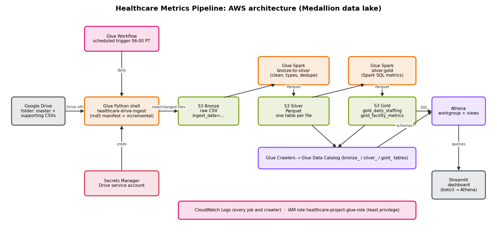

# Healthcare Staffing Metrics: AWS Data Lake Pipeline + Streamlit Dashboard

An AWS pipeline that ingests CMS nursing home data **incrementally from Google Drive**, refines it through a
Bronze → Silver → Gold data lake on S3 with AWS Glue (PySpark), serves it with Athena, and presents staffing,
occupancy and quality metrics in a Streamlit dashboard.



## Results at a glance

See [`docs/metrics_and_findings.md`](docs/metrics_and_findings.md) for the 5 metrics, the answers to the 4 business
questions, and conclusions.

## Repository layout

```
glue/                       the three Glue jobs (deployed to s3://aws-glue-assets-…/scripts/)
  healthcare-drive-ingest.py     Python shell: Google Drive -> S3 Bronze, incremental by md5 manifest
  healthcare-bronze-to-silver.py Spark: clean CSV -> Parquet, incremental by S3 ETag state
  healthcare-silver-gold.py      Spark SQL: Gold tables, skipped when Silver is unchanged
sql/
  views/                    Athena views (serving layer, created by deploy.py)
  metrics/                  Step 5: the 5 metric queries
  questions/                the 4 business questions
scripts/
  deploy.py                 uploads Glue code, creates the Glue Workflow + schedule, Athena workgroup and views
  run_metrics.py            runs every metric/question query, saves results/*.csv
  athena_client.py          small Athena helper shared by the scripts and the dashboard
  generate_architecture_diagram.py  docs/architecture.png + .drawio
eda/profile_data.py         Steps 1-2: integrity check + missing values / duplicates / outliers report
dashboard/app.py            Step 6: Streamlit dashboard
docs/                       design doc, data dictionary, EDA report, findings, diagram, state-file snapshots
results/                    query outputs (CSV) from run_metrics.py
```

## AWS resources (account 499502048569, us-west-1)

| Resource | Name |
|---|---|
| S3 data lake | `healthcare-project122` (`Bronze/`, `Silver/`, `Gold/`, `_state/`, `athena-results/`) |
| Glue jobs | `healthcare-drive-ingest`, `healthcare-bronze-to-silver`, `healthcare-silver-gold` |
| Glue Workflow | `healthcare-daily-pipeline` (trigger `healthcare-daily-start`, daily 06:00 PT) |
| Glue crawlers | `healthcare-crawler-bronze`, `heatlhcare-crawler-silver`, `healthcare-crawler-gold` |
| Glue database | `healthcare-project` |
| Athena workgroup | `healthcare-analytics` |
| Secret | `healthcare-project/drive-service-account` (Google service account JSON) |
| IAM role | `healthcare-project-glue-role` |
| Source | Google Drive folder `healthcare-source-data`, shared read-only with the service account |

## Setup

Requirements: Python 3.9+, AWS CLI logged in (`aws login --profile admin`), access to the AWS account above.

```bash
python3 -m venv ~/.venvs/healthcare
~/.venvs/healthcare/bin/pip install -r requirements.txt
export AWS_PROFILE=admin
```

## Run it

```bash
# Steps 1-2: integrity + data profiling (reads the CSVs in ../data)
python eda/profile_data.py

# Step 4: deploy / update the pipeline (first time ever: add --skip-views, run the workflow, then re-run without it)
python scripts/deploy.py            # add --run to start the workflow immediately

# Step 5: compute the metrics and answers
python scripts/run_metrics.py

# Step 6: dashboard (opens http://localhost:8501)
streamlit run dashboard/app.py
```

**Adding data:** drop a CSV into the Drive folder. The next daily run downloads only that file, creates its Bronze and
Silver tables, catalogs them, and rebuilds Gold. Unchanged files are never downloaded again.

**Monitoring:** Glue console → Workflows → `healthcare-daily-pipeline` → History (graph shows each step);
logs in CloudWatch under `/aws-glue/jobs/` and `/aws-glue/python-jobs/`.

**Stopping costs:** `aws glue stop-trigger --name healthcare-daily-start --region us-west-1` (≈ $5–6/month if left on).

## Documentation

- [Solution design document](docs/solution_design_doc.md): architecture, the WHY behind each service, incremental logic, assumptions, cost
- [Data dictionary](docs/data_dictionary.md): every layer, table and derived column
- [EDA report](docs/eda_report.md): Steps 1–2, file integrity, missing values, duplicates, outliers, charts
- [Metrics and findings](docs/metrics_and_findings.md): Step 5 and the 4 questions

## Data source

CMS Payroll-Based Journal Daily Nurse Staffing, Q2 2024, plus CMS Nursing Home Compare supporting files
(Provider Info, SNF VBP, claims and MDS quality measures, penalties), Oct 2024 release.
