# Steps 1–2: Source Data Integrity and Initial Data Analysis

Generated by `eda/profile_data.py`. Re-run it after adding files to `data/`.

## Step 1: Integrity check

Every file was opened with pandas, its rows were counted, and its MD5 was compared with the checksum Google Drive reports for the same file (recorded by the ingest job in `drive_manifest.json`).

| file | size_mb | opens | rows | columns | md5_matches_drive |
|---|---|---|---|---|---|
| FY_2024_SNF_VBP_Aggregate_Performance.csv | 0.0 | yes | 1 | 9 | yes |
| FY_2024_SNF_VBP_Facility_Performance.csv | 1.8 | yes | 10858 | 20 | yes |
| NH_CitationDescriptions_Oct2024.csv | 0.1 | yes | 641 | 5 | yes |
| NH_CovidVaxAverages_20241027.csv | 0.0 | yes | 54 | 4 | yes |
| NH_CovidVaxProvider_20241027.csv | 0.6 | yes | 14814 | 5 | yes |
| NH_DataCollectionIntervals_Oct2024.csv | 0.0 | yes | 45 | 6 | yes |
| NH_FireSafetyCitations_Oct2024.csv | 69.2 | yes | 200003 | 24 | yes |
| NH_HealthCitations_Oct2024.csv | 158.9 | yes | 402424 | 23 | yes |
| NH_HlthInspecCutpointsState_Oct2024.csv | 0.0 | yes | 53 | 6 | yes |
| NH_Ownership_Oct2024.csv | 33.2 | yes | 145354 | 13 | yes |
| NH_Penalties_Oct2024.csv | 4.7 | yes | 28505 | 13 | yes |
| NH_ProviderInfo_Oct2024.csv | 9.4 | yes | 14814 | 103 | yes |
| NH_QualityMsr_Claims_Oct2024.csv | 16.7 | yes | 59256 | 17 | yes |
| NH_QualityMsr_MDS_Oct2024.csv | 80.7 | yes | 266652 | 23 | yes |
| NH_StateUSAverages_Oct2024.csv | 0.0 | yes | 54 | 48 | yes |
| NH_SurveyDates_Oct2024.csv | 8.3 | yes | 159723 | 5 | yes |
| NH_SurveySummary_Oct2024.csv | 10.0 | yes | 44243 | 41 | yes |
| PBJ_Daily_Nurse_Staffing_Q2_2024.csv | 219.7 | yes | 1325324 | 33 | yes |
| Skilled_Nursing_Facility_Quality_Reporting_Program_National_Data_Oct2024.csv | 0.0 | yes | 24 | 7 | yes |
| Skilled_Nursing_Facility_Quality_Reporting_Program_Provider_Data_Oct2024.csv | 155.9 | yes | 711072 | 16 | yes |
| Swing_Bed_SNF_data_Oct2024.csv | 6.6 | yes | 38064 | 16 | yes |

## Schema and relationships

The facility key is the 6-character CMS Certification Number: `PROVNUM` in PBJ, `CMS Certification Number (CCN)` in the supporting files. It is text (leading zeros matter). In Silver it is renamed `ccn` and zero-padded to 6 characters in every table, so all joins use `ccn`.

| file | key column | grain (one row per) | distinct facilities | facilities also in PBJ |
|---|---|---|---|---|
| FY_2024_SNF_VBP_Aggregate_Performance.csv | (none: state level) | state |  |  |
| FY_2024_SNF_VBP_Facility_Performance.csv | CMS Certification Number (CCN) | facility | 10858 | 10,595 |
| NH_CitationDescriptions_Oct2024.csv | (none: state level) | state |  |  |
| NH_CovidVaxAverages_20241027.csv | (none: state level) | state |  |  |
| NH_CovidVaxProvider_20241027.csv | CMS Certification Number (CCN) | facility | 14814 | 14,547 |
| NH_DataCollectionIntervals_Oct2024.csv | (none: state level) | state |  |  |
| NH_FireSafetyCitations_Oct2024.csv | CMS Certification Number (CCN) | facility per measure/event | 14019 | 13,784 |
| NH_HealthCitations_Oct2024.csv | CMS Certification Number (CCN) | facility per measure/event | 14719 | 14,476 |
| NH_HlthInspecCutpointsState_Oct2024.csv | (none: state level) | state |  |  |
| NH_Ownership_Oct2024.csv | CMS Certification Number (CCN) | facility per measure/event | 14814 | 14,547 |
| NH_Penalties_Oct2024.csv | CMS Certification Number (CCN) | facility per measure/event | 9255 | 9,093 |
| NH_ProviderInfo_Oct2024.csv | CMS Certification Number (CCN) | facility | 14814 | 14,547 |
| NH_QualityMsr_Claims_Oct2024.csv | CMS Certification Number (CCN) | facility per measure/event | 14814 | 14,547 |
| NH_QualityMsr_MDS_Oct2024.csv | CMS Certification Number (CCN) | facility per measure/event | 14814 | 14,547 |
| NH_StateUSAverages_Oct2024.csv | (none: state level) | state |  |  |
| NH_SurveyDates_Oct2024.csv | CMS Certification Number (CCN) | facility per measure/event | 14814 | 14,547 |
| NH_SurveySummary_Oct2024.csv | CMS Certification Number (CCN) | facility per measure/event | 14814 | 14,547 |
| PBJ_Daily_Nurse_Staffing_Q2_2024.csv | PROVNUM | facility per day | 14564 | 14,564 |
| Skilled_Nursing_Facility_Quality_Reporting_Program_National_Data_Oct2024.csv | CMS Certification Number (CCN) | facility per measure/event | 1 | 0 |
| Skilled_Nursing_Facility_Quality_Reporting_Program_Provider_Data_Oct2024.csv | CMS Certification Number (CCN) | facility per measure/event | 14814 | 14,547 |
| Swing_Bed_SNF_data_Oct2024.csv | CMS Certification Number (CCN) | facility per measure/event | 793 | 0 |

## Step 2: Missing values, duplicates, outliers

### PBJ_Daily_Nurse_Staffing_Q2_2024.csv (master file)

- Rows: **1,325,324**, columns: **33**, facilities: **14,564**, states/territories: **52**
- Dates: **2024-04-01 to 2024-06-30** (91 days, Q2 2024 only)
- Missing values: **0** cells
- Exact duplicate rows: **0**; duplicate facility+date: **0**
- Negative hours: **0**
- Facility-days with census 0: **320**
- Facility-days with census > 0 but 0 RN+LPN+CNA hours (likely unreported): **2,939**
- Nurse HPRD: median **3.25**, max **193**; **55** facility-days above 24 (impossible: more than 24 hours per resident per day)
- IQR outlier rule on HPRD (outside 1.29 to 5.28): **58,845** facility-days (4.4%). Most are legitimately high or low staffing, so only the impossible and unreported rows are excluded, via `is_valid_day` in Gold
- `Hrs_X = Hrs_X_emp + Hrs_X_ctr` holds for RN, LPN and CNA: **yes**
- Contract staff share of RN+LPN+CNA hours: **7.7%**

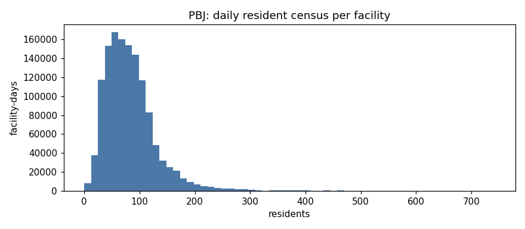
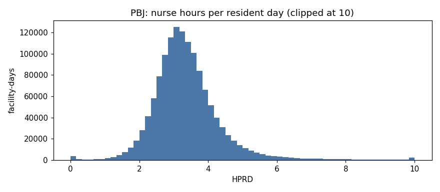
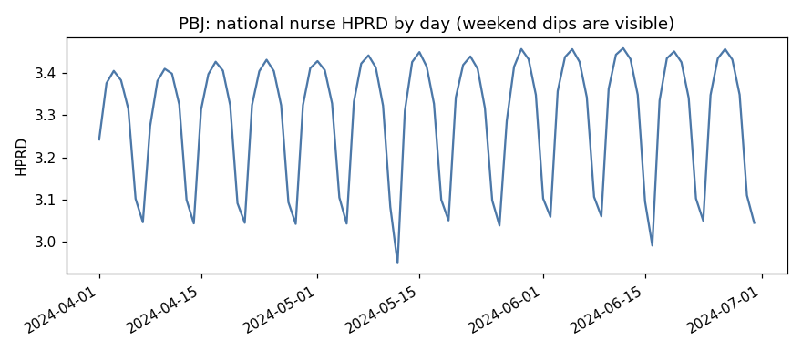

### FY_2024_SNF_VBP_Aggregate_Performance.csv

No missing values.

### FY_2024_SNF_VBP_Facility_Performance.csv

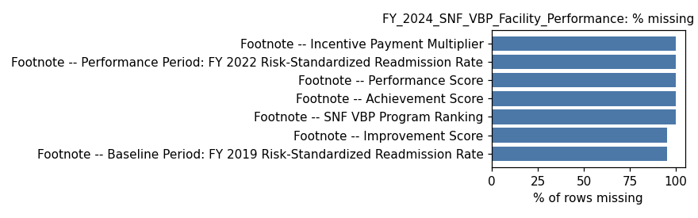

### NH_CitationDescriptions_Oct2024.csv

No missing values.

### NH_CovidVaxAverages_20241027.csv

No missing values.

### NH_CovidVaxProvider_20241027.csv

No missing values.

### NH_DataCollectionIntervals_Oct2024.csv

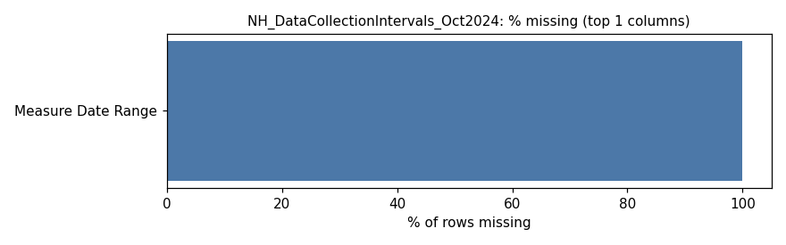

### NH_FireSafetyCitations_Oct2024.csv

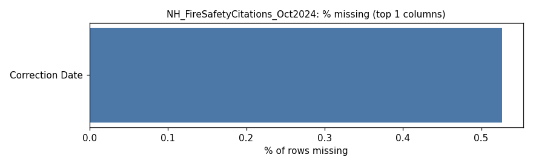

### NH_HealthCitations_Oct2024.csv

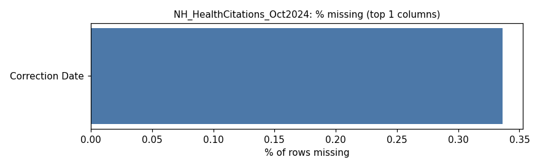

### NH_HlthInspecCutpointsState_Oct2024.csv

No missing values.

### NH_Ownership_Oct2024.csv

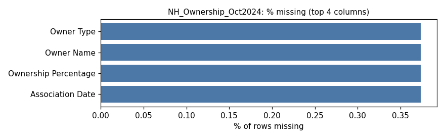

### NH_Penalties_Oct2024.csv

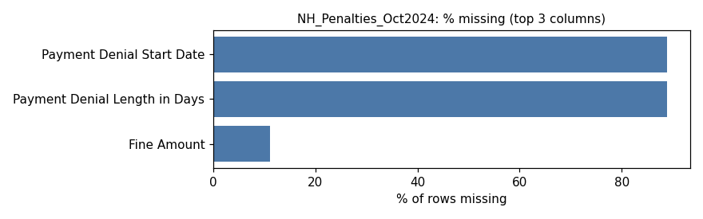

### NH_ProviderInfo_Oct2024.csv

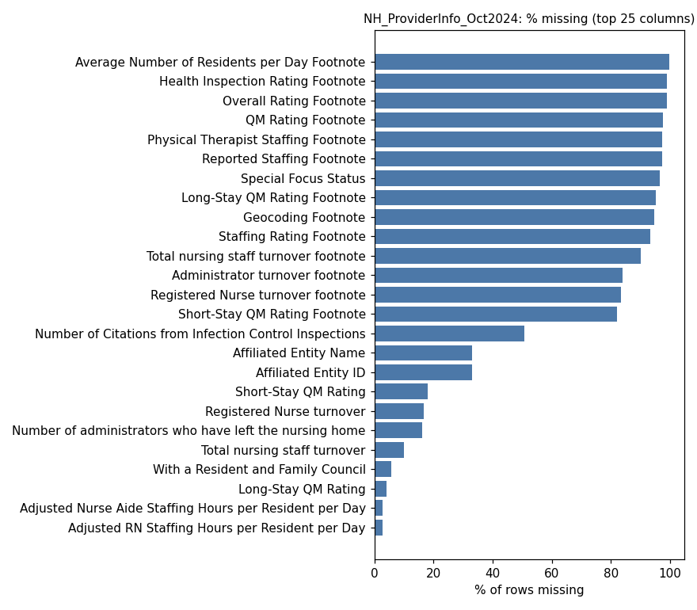

### NH_QualityMsr_Claims_Oct2024.csv

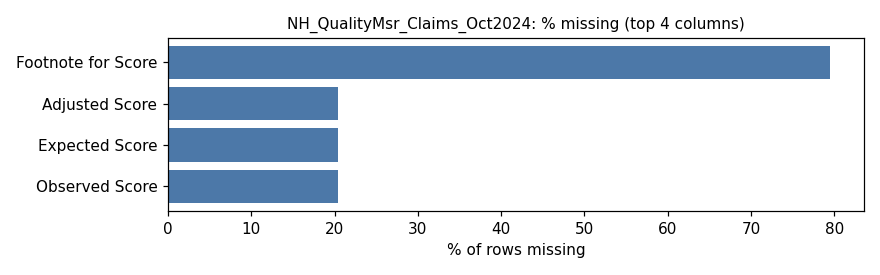

### NH_QualityMsr_MDS_Oct2024.csv

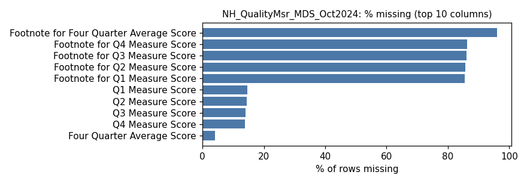

### NH_StateUSAverages_Oct2024.csv

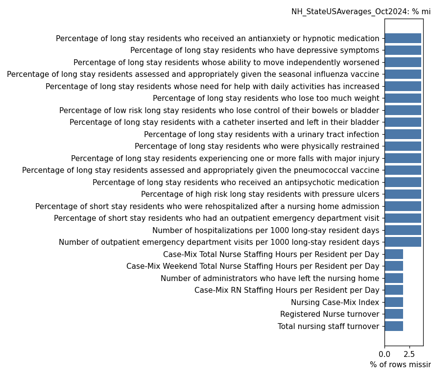

### NH_SurveyDates_Oct2024.csv

No missing values.

### NH_SurveySummary_Oct2024.csv

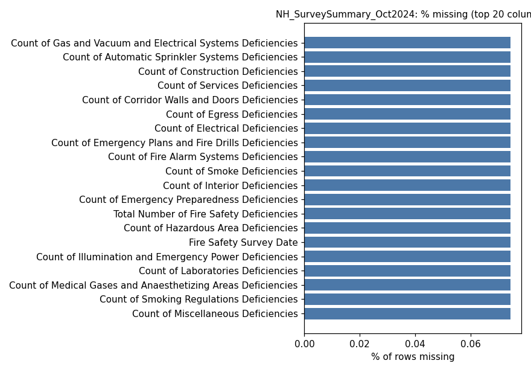

### Skilled_Nursing_Facility_Quality_Reporting_Program_National_Data_Oct2024.csv

No missing values.

### Skilled_Nursing_Facility_Quality_Reporting_Program_Provider_Data_Oct2024.csv

No missing values.

### Swing_Bed_SNF_data_Oct2024.csv

No missing values.

### Summary across files

| file | rows | cells missing | columns >50% missing | fully empty columns | duplicate rows |
|---|---|---|---|---|---|
| FY_2024_SNF_VBP_Aggregate_Performance.csv | 1 | 0.0% | 0 | 0 | 0 |
| FY_2024_SNF_VBP_Facility_Performance.csv | 10,858 | 34.5% | 7 | 5 | 0 |
| NH_CitationDescriptions_Oct2024.csv | 641 | 0.0% | 0 | 0 | 0 |
| NH_CovidVaxAverages_20241027.csv | 54 | 0.0% | 0 | 0 | 0 |
| NH_CovidVaxProvider_20241027.csv | 14,814 | 0.0% | 0 | 0 | 0 |
| NH_DataCollectionIntervals_Oct2024.csv | 45 | 16.7% | 1 | 1 | 0 |
| NH_FireSafetyCitations_Oct2024.csv | 200,003 | 0.0% | 0 | 0 | 0 |
| NH_HealthCitations_Oct2024.csv | 402,424 | 0.0% | 0 | 0 | 0 |
| NH_HlthInspecCutpointsState_Oct2024.csv | 53 | 0.0% | 0 | 0 | 0 |
| NH_Ownership_Oct2024.csv | 145,354 | 0.1% | 0 | 0 | 0 |
| NH_Penalties_Oct2024.csv | 28,505 | 14.5% | 2 | 0 | 0 |
| NH_ProviderInfo_Oct2024.csv | 14,814 | 15.2% | 15 | 0 | 0 |
| NH_QualityMsr_Claims_Oct2024.csv | 59,256 | 8.3% | 1 | 0 | 0 |
| NH_QualityMsr_MDS_Oct2024.csv | 266,652 | 21.7% | 5 | 0 | 0 |
| NH_StateUSAverages_Oct2024.csv | 54 | 2.0% | 0 | 0 | 0 |
| NH_SurveyDates_Oct2024.csv | 159,723 | 0.0% | 0 | 0 | 0 |
| NH_SurveySummary_Oct2024.csv | 44,243 | 0.0% | 0 | 0 | 0 |
| PBJ_Daily_Nurse_Staffing_Q2_2024.csv | 1,325,324 | 0.0% | 0 | 0 | 0 |
| Skilled_Nursing_Facility_Quality_Reporting_Program_National_Data_Oct2024.csv | 24 | 0.0% | 0 | 0 | 0 |
| Skilled_Nursing_Facility_Quality_Reporting_Program_Provider_Data_Oct2024.csv | 711,072 | 0.0% | 0 | 0 | 0 |
| Swing_Bed_SNF_data_Oct2024.csv | 38,064 | 0.0% | 0 | 0 | 0 |

### Certified beds (needed for occupancy)

- Median **100** beds, max **843**; IQR outliers: **569** facilities above 218 beds (large facilities, kept)

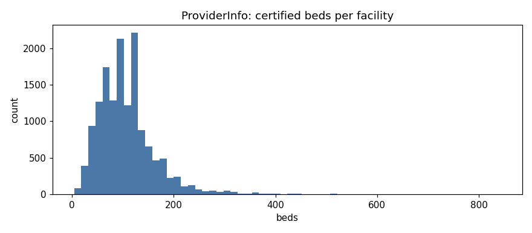

## What this means for the pipeline

- Silver: snake_case names, `ccn` key padded to 6, empty strings to null, fully empty columns dropped, types inferred, exact duplicates removed.
- Gold: `is_valid_day` excludes census-0 days, unreported days (0 nurse hours) and impossible HPRD (> 24). Facility and state metrics use valid days only.
- PBJ has no overtime, shift, cost, department, time-of-day or length-of-stay fields; see `docs/metrics_and_findings.md` for which spec metrics are possible.

You'd build your own EDA report by answering the same few questions for every file, then writing down what you found.

The idea: an EDA (exploratory data analysis) is a health check on data before you build anything with it. For each file you ask:

1. Did it arrive complete? (integrity)
2. What's in it? (columns, types, row count)
3. What's missing? (nulls)
4. What's repeated? (duplicates)
5. What looks wrong? (outliers, impossible values)
6. How does it connect to the other files? (join keys)

Picture it like a doctor's checkup form: same checklist for every patient (file), notes on anything unusual, and a summary at the end.

Walkthrough: do it on ONE file first (the master)

Open Terminal, start Python with your project's environment:
~/.venvs/healthcare/bin/python

Then type these lines one at a time and read each result:

import pandas as pd
df = pd.read_csv("/Users/raidriar/Library/Mobile Documents/com~apple~CloudDocs/1 - Data Engineering Academy/1 - Projects & Demos/Healthcare Orange Project/data/PBJ_Daily_Nurse_Staffing_Q2_2024.csv", encoding="latin-1")

1. Shape (did it load completely?)
df.shape
→ (rows, columns). Write down the numbers.

2. What's in it?
df.head()
df.dtypes
→ the first 5 rows, then each column's type. Ask yourself: is WorkDate a number when it should be a date? Is PROVNUM a number when it should be text (leading zeros)?

3. Missing values
df.isnull().sum()
→ the count of blanks per column.

4. Duplicates
df.duplicated().sum()
df.duplicated(subset=["PROVNUM", "WorkDate"]).sum()
→ the first counts fully identical rows. The second counts repeats of the same facility on the same day, which should be 0 for this grain.

5. Outliers
df.describe()
→ min, max and average for every number column. Look for impossible values: negative hours, a census of 0, a max that's 100× the average.

6. One chart
import matplotlib.pyplot as plt
df["MDScensus"].hist(bins=50)
plt.savefig("hist_census.png")

Then write the report

Make a file my_eda.md and, for each file, write:
- rows / columns
- columns with missing values, and how many
- duplicates found (yes/no, how many)
- anything weird from describe()
- what you'll do about it in the pipeline, e.g. "census = 0 days are excluded from ratios"